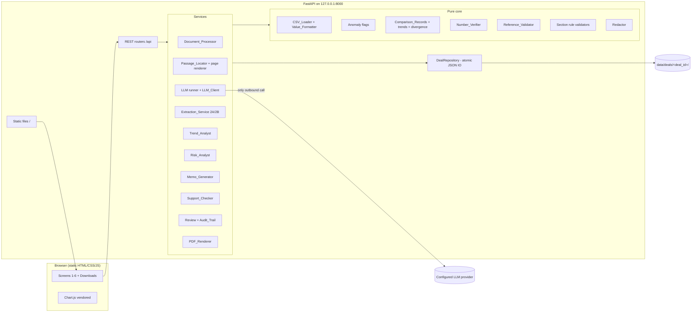
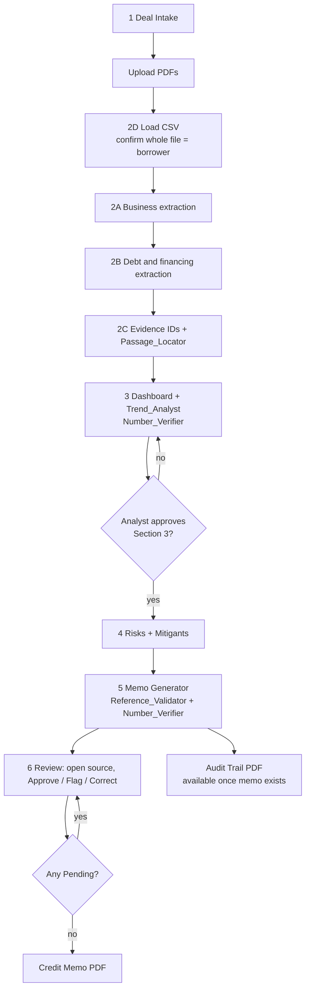
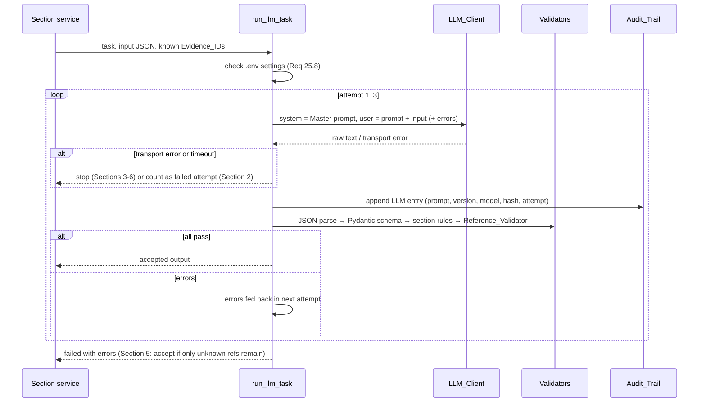

# Design Document: AI-Assisted Credit Analysis App

## Overview

The Credit_Analysis_App is a local, single-user prototype that runs the six-section pipeline from the updated Project Details: Deal Intake (1) → Extraction (2) → Financial Trend Dashboard + AI Analysis with approval gate (3) → Risks + Mitigants (4) → Credit Memo with Evidence (5) → Analyst Review + Source Verification with Credit Memo PDF and Audit Trail PDF (6). The design also covers the rewrite of `Instructions.md` and the versioned runtime prompt files that must match it.

The design follows one rule throughout: **the LLM interprets and drafts, Python calculates and verifies, the Analyst decides.**

| Concern | Done by | Never done by |
|---|---|---|
| Qualitative / debt facts from PDFs | LLM (Sections 2A, 2B), each tied to an `EV-###` | Backend |
| Locating the passage on the PDF page | PyMuPDF (Passage_Locator) | LLM |
| Historical figures and credit metrics | CSV + Pandas (CSV_Loader) | LLM, Backend arithmetic on ratios |
| Period-over-period change and direction | Backend (Comparison_Records) | LLM |
| Interpretation, risks, memo text | LLM (Sections 3, 4, 5) | Backend |
| Checking every figure and citation | Number_Verifier, Reference_Validator | LLM |
| Approve / flag / correct, final sign-off | Analyst | LLM, Backend |

### Key design decisions

1. **One process, one port.** FastAPI serves both the REST API (`/api/...`) and the static Frontend (`/`) on `127.0.0.1:8000`. No Node.js, no build step, Chart.js vendored as a UMD file.
2. **Per-Deal JSON folders.** Every Deal lives in `data/deals/<deal_id>/`. Writes are atomic (`write temp → os.replace`) and serialised per Deal with a lock. No database server.
3. **Pure core, thin I/O shell.** CSV parsing, value formatting, anomaly flags, comparisons, number tokenising, reference validation, ordering rules, filename sanitising and redaction are pure functions. This keeps them property-testable and makes the LLM/PDF/HTTP layers thin.
4. **Single LLM runner.** All six LLM tasks go through one `run_llm_task()` loop: build input → call LLM_Client → schema validate → section validators → Reference_Validator → retry with errors (max 3 attempts) → audit entry per returned output.
5. **Deterministic facts are pre-computed and handed to the LLM.** Comparison_Records, sustained-trend labels, divergence assessability and the Unavailable_Metric list are computed by the Backend and supplied as input, so the LLM only quotes.
6. **Custom passage normalisation.** PyMuPDF's `Page.search_for()` ignores case but does not apply the Requirement 7.5 normalisation (de-hyphenation, quote/dash folding). The Passage_Locator therefore builds a normalised character stream from `page.get_text("rawdict")` with a per-character bounding box map, finds the excerpt in it, and unions the boxes of the matched characters per line ([PyMuPDF TextPage docs](https://pymupdf.readthedocs.io/en/latest/textpage.html), [text extraction appendix](https://pymupdf.readthedocs.io/en/latest/app1.html)).
7. **Highlights without modifying stored files.** Page images are rendered from an in-memory copy of the PDF with highlight annotations added and `get_pixmap(dpi=150, annots=True)`; the stored upload is never saved over.
8. **Gaps in charts.** Chart.js leaves a gap for `null` data when `spanGaps` is false (the default), which satisfies Requirement 13.7 without extra code ([Chart.js gap behaviour discussion](https://stackoverflow.com/questions/34516224/not-drawing-null-values-using-chart-js)). Point labels are drawn by a small inline Chart.js plugin, so no extra plugin library is vendored.

### Research summary

- **PyMuPDF**: `get_text("rawdict")` gives characters with individual bboxes (used for normalised matching and highlight rectangles); `search_for()` returns rectangles but is case-insensitive only and cannot apply custom normalisation; `get_pixmap(dpi=...)` renders a page image; annotations on an unsaved document affect rendering only.
- **Chart.js 4 UMD build** (`chart.umd.js`) works from a local `<script>` tag with no bundler. Multiple charts per panel are used instead of multiple y-axes so that no two unit types share an axis.
- **Provider APIs**: OpenAI Chat Completions (`response_format: json_object`), Gemini `generateContent` (`responseMimeType: application/json`) and Anthropic Messages (JSON enforced by prompt + parser) are called with `httpx`, temperature 0, 120 s timeout.

### Confirmed: transport retry rule

Retry in Section 2 only, stop elsewhere. Section 2 extraction requests count provider errors and timeouts against the same 2-retry budget (Req 5.6, 6.7). Sections 3, 4, 5 and 6 stop immediately on a network/provider error or timeout, with no automatic retry (Req 25.9). Schema and reference failures retry in every section.

## Architecture



### Pipeline and gates



### LLM runner (all sections)



### Section re-run and staleness

`deal.json` holds a `sections` map (`s2a, s2b, s3, s4, s5, s6_support`) with `status ∈ {not_run, completed, failed, stale}`. A successful re-run of Section N marks every later section `stale` (kept, viewable, labelled "Out of date") and, for Section 3, resets approval. A failed run never changes stored outputs (Req 5.6, 6.7, 25.5).

## Project Folder Structure

```
Full Stack Application/
├─ Instructions.md                 # rewritten (Req 1)
├─ intel_quarterly_ratios.csv      # default Financial_Database
├─ start.bat                       # Launcher (Req 26)
├─ requirements.txt                # exact pins
├─ .env.example  .gitignore        # .gitignore: .env, .venv/, data/
├─ config/analysis.toml            # thresholds, stable bands, keywords, limits
├─ tools/
│  ├─ wait_for_health.py           # polls http://127.0.0.1:<port>/api/health
│  ├─ check_python.py  port_free.py
│  └─ sync_prompts.py              # extracts prompt blocks from Instructions.md into prompt files
├─ backend/
│  ├─ app/
│  │  ├─ main.py                   # app factory, startup checks, static mount, error handlers
│  │  ├─ settings.py               # .env (pydantic-settings) + analysis.toml (tomllib)
│  │  ├─ api/                      # routers: deals, documents, financial, sections, review, exports, evidence
│  │  ├─ models/                   # Pydantic: deal, document, evidence, financial, llm_schemas, review, audit
│  │  ├─ storage/repository.py     # DealRepository, per-deal locks, atomic writes
│  │  ├─ documents/                # processor.py, passage_locator.py, normalise.py, render.py
│  │  ├─ financial/                # csv_loader.py, values.py, anomalies.py, comparisons.py,
│  │  │                            # unavailable.py, divergence.py, trends.py, dashboard.py
│  │  ├─ llm/                      # client.py, providers/{openai,gemini,anthropic}.py, prompts.py, runner.py
│  │  ├─ sections/                 # s2_extraction.py, s3_trend.py, s4_risks.py, s5_memo.py, s6_support.py
│  │  ├─ verification/             # numbers.py, references.py, text_rules.py
│  │  ├─ review/                   # section3_gate.py, memo_review.py, audit_trail.py
│  │  ├─ export/                   # memo_pdf.py, audit_pdf.py, filenames.py, citations.py
│  │  ├─ security/redact.py
│  │  └─ prompts/                  # master_system.md, s2a_business.md, s2b_debt.md, s3_trend.md,
│  │                               # s4_risks.md, s5_memo.md, s6_support.md
│  └─ tests/                       # unit/, property/, golden/, integration/, conftest.py
├─ frontend/
│  ├─ index.html
│  ├─ css/app.css
│  ├─ js/ app.js api.js state.js a11y.js charts.js
│  ├─ js/screens/ intake.js documents.js section2.js dashboard.js risks.js memo.js review.js
│  └─ vendor/chart.umd.min.js      # Chart.js 4.x, pinned, no CDN
└─ data/                           # git-ignored runtime data
```

## Components and Interfaces

### C1. Instructions file and prompt files (Req 1)

`Instructions.md` is rewritten with this outline:

1. Project overview: purpose, Sections 1-6 pipeline table (Section 6 → Credit Memo PDF + Audit Trail PDF via PDF_Renderer), principles.
2. Runtime constraints: FastAPI Python-only Backend, static Frontend served by the Backend, `.env` provider via LLM_Client only, `start.bat` single double-click, local single user with no authentication (must add before any shared/networked deployment).
3. Data conventions: three Evidence_ID formats with one example each (`EV-007`, `CSV-DSCR-Q2-2026`, `DI-AMOUNT`); vocabularies (Statement_Label, Verification_Status, direction); ten Canonical_Metrics in order; five Anomaly_Flag triggers with large-swing thresholds; Stable_Band defaults; financial-data rule (CSV only, Pandas, no ratio calculation by Backend or LLM, zero is a real value with a flag, Unavailable_Metrics → "Not available in database").
4. Section 6 verification in the Frontend (Evidence_ID opens Evidence_Record; Support_Checker advisory only).
5. Master System Prompt with rules (a)-(h) of Req 1.2.
6. Six runtime prompts: S2A, S2B, S3, S4, S5, S6. Each has `Prompt ID`, `Version` and a fenced `text` block, followed by its JSON output schema table (field, type, required).

No "Layer" numbering, credit-engine formulas, derived-figure rules, recommendation or blind-spots fields remain.

**Prompt file format** (`backend/app/prompts/<name>.md`):

```
version: S3-v1.0
---
<prompt text, identical to the fenced block in Instructions.md>
```

`prompts.py`:

```python
@dataclass(frozen=True)
class PromptFile: prompt_id: str; version: str; text: str

REQUIRED = ["S2A", "S2B", "S3", "S4", "S5", "S6"]  # plus MASTER
def load_prompts(folder: Path) -> dict[str, PromptFile]  # raises PromptLoadError(prompt_id, reason)
def extract_instruction_prompts(md_text: str) -> dict[str, PromptFile]  # used by tests + sync tool
```

At startup `main.py` calls `load_prompts`; any missing/unreadable file or missing `version:` line raises `PromptLoadError`, start-up aborts with a message naming the prompt, and no LLM_Client is constructed (Req 1.10). `test_prompt_sync.py` asserts version and text equality (line endings normalised) between each file and `Instructions.md` (Req 1.8). Placeholder in every prompt: `{{INPUT_JSON}}`.

### C2. Settings (`settings.py`)

- `.env` (secrets + provider): `LLM_PROVIDER` (`openai|gemini|anthropic`), `LLM_MODEL`, `LLM_API_KEY`, `SUPPORT_CHECK_ENABLED` (default false), `PORT` (default 8000), `FINANCIAL_DB_PATH` (optional).
- `config/analysis.toml`: `max_upload_mb=50`, `max_csv_mb=5`, `page_limit=30` (1-200), `llm_timeout_s=120`, `llm_max_retries=2`, `[large_swing]` percent=10.0 multiple=2.0 days=5.0 amount_relative_pct=50.0, `[stable_band]` percent=1.0 multiple=0.10 amount_relative_pct=5.0 days=3.0, `[keywords] business=[...]`, `debt=[...]`.
- `resolve_thresholds(raw) -> (values, defaulted_unit_types)` and `resolve_stable_bands(raw)` apply defaults per unit type for missing / non-numeric / invalid values (Req 10.8: ≤ 0 invalid; Req 12.9: negative invalid) and report defaults applied.
- Host is fixed to `127.0.0.1` (not configurable) (Req 27.5).
- `llm_settings_problems() -> list[str]` returns names of missing/invalid `.env` settings, never values (Req 25.8, 27.4).

### C3. Deal intake (Req 2)

`POST /api/deals` with `DealIntakeRequest`. Validation (`models/deal.py`), applied after trimming:

| Field | Rule |
|---|---|
| borrower | required, ≤ 200 chars |
| facility_type, tenor | required, ≤ 100 chars |
| amount | required, regex `^\d+(\.\d{1,2})?$`, 0.01 ≤ value ≤ 999,999,999,999.99 (Decimal) |
| currency | required, `^[A-Za-z]{3}$` |
| purpose, repayment | required, ≤ 2,000 chars |
| collateral | optional, ≤ 2,000; empty → `"None provided"` |

All failing fields are collected and returned together (`fields: [{field, reason}]`); no Deal is created on any failure. Stored fields map to `DI-BORROWER`, `DI-FACILITY_TYPE`, `DI-AMOUNT` (`{amount, currency}`, display `"<amount> <currency>"`), `DI-PURPOSE`, `DI-TENOR`, `DI-REPAYMENT`, `DI-COLLATERAL`. Deal creation also creates an empty `audit_trail.json` (Req 22.1).

### C4. Document upload and processing (Req 3, 4)

`POST /api/deals/{id}/documents` (multipart: `file`, `doc_type`, `period_covered`, `audited`, optional `display_name`).

Upload pipeline: stream to temp file with size counter (reject when `> max_upload_mb * 1024*1024`; exactly at limit accepted) → `fitz.open()`; reject if open fails, `doc.needs_pass`/`is_encrypted`, or `page_count == 0` → assign `doc_id = "D" + str(deal.next_doc_seq)` and increment (counter is never decremented) → move file to `documents/D<n>.pdf` → extract every page with `page.get_text("text")` → store `pages/D<n>.json`. Pages with 0 non-whitespace characters are `no_text_layer=true`; their numbers are returned as warnings. A Document with all pages `no_text_layer` gets `extraction_excluded=true` (Req 3.8). A stored Document that later fails to open is marked `failed` with a reason (Req 4.6).

`documents/processor.py` (pure where possible):

```python
def page_tag(doc_id: str, doc_name: str, page: int) -> str  # "[[DOC D1 | Intel 10-K | PAGE 72]]"
def select_pages(pages: list[PageText], keywords: list[str]) -> list[PageText]  # case-insensitive, any keyword
def order_key(p: PageText) -> tuple[int, int]  # (int(doc_id[1:]), page)
def batch_pages(pages: list[PageText], limit: int) -> list[list[PageText]]  # sorted by order_key, chunks ≤ limit
def render_batch(batch: list[PageText]) -> str  # tag line + "\n" + text for every page
```

Selection runs over Documents that are neither `failed` nor `extraction_excluded`. A page matching both scopes is in both scope requests.

### C5. Extraction_Service (Req 5, 6)

`sections/s2_extraction.py` runs 2A then 2B. For each scope:

1. `select_pages` → if empty: no LLM call, record every field `Not available` and message "No relevant pages found for <scope>" (Req 4.7, 5.7, 6.3).
2. `batch_pages` → one `run_llm_task` per batch. Each batch's allowed `(doc_id, page)` set = its Page_Tags.
3. Per-item validation (`validate_2a_item` / `validate_2b_item`, pure):
   - required: non-empty `statement`, `doc_id`, `page`, `section_heading`, `excerpt`; `(doc_id, page)` in the batch's tag set; excerpt 1-500 chars.
   - 2A: statement ≤ 300 chars and ≤ 2 sentences; ≤ 5 items kept per field (extra items rejected with reason "More than 5 items for this field").
   - 2B: statement ≤ 2 sentences; every numeric token in the statement appears verbatim (normalised per Req 15.2) in its excerpt (Req 6.5).
   - Rejected items are stored under `rejected_items` of the field with reason (2A) or issue `"Invalid output"` (2B); no Evidence_ID.
4. Merge batch results ordered by `order_key` (Req 4.5).
5. 2B conflict detection: the S2B schema asks the LLM for `item_key` (e.g. "2029 senior notes") and `as_of` per item. The Backend groups merged items by `(normalised item_key, as_of)`; a group whose items come from ≥ 2 distinct doc_ids and whose numeric token sets differ becomes one field entry with issue `"Conflicting"`, all candidates listed, `preferred = null` (Req 6.4). Each candidate is stored evidence with its own `EV-###`.
6. Fields with no accepted item → `{statement: null, issue: "Not available"}`, no Evidence_ID, no Passage_Locator call (Req 5.3, 7.8).
7. Assign Evidence_IDs (C6) and run the Passage_Locator before storing the Evidence_Record.

Transport errors and schema failures in Section 2 consume the retry budget (see conflict note). After the final failure the scope is marked failed and nothing from the run is stored (Req 5.6, 6.7).

Sentence counting (`text_rules.count_sentences`): count `[.!?]` followed by whitespace or end of string; decimals like `25.40` are not terminators.

### C6. Evidence IDs and Passage_Locator (Req 7)

`deal.json.next_ev_seq` starts at 1 and only increases. `format_ev_id(n) = f"EV-{n:03d}"` (≥ 3 digits; `EV-1000` after `EV-999`). IDs are assigned in order: 2A fields in fixed order → items in merged order, then 2B the same. On re-run of a scope, the scope's previous records move to `evidence_archive.json` (kept for audit, no longer active) and new records get new numbers; the Evidence_Store holds only active records, so the Reference_Validator never accepts archived IDs.

`documents/normalise.py` (pure):

```python
def normalise(s: str) -> str:
    # (a) "-\n" (optional spaces around the line break) -> "" ; (b) \s+ -> " ", strip
    # (c) lower() ; (d) ‘ ’ ‚ ‛ ′ -> '   “ ” „ ‟ ″ -> " ; (e) – — -> -
def normalise_with_map(chars: list[tuple[str, Rect]]) -> tuple[str, list[int]]
    # same transform, returns normalised string + index into source char list per output char
```

`passage_locator.locate(pdf_path, page_no, excerpt) -> LocateResult(status, rects, issue)`:

1. Validate reference: Document exists, `1 ≤ page ≤ page_count`, `normalise(excerpt) != ""`; otherwise `Not located` + issue (`"Invalid reference: unknown document"`, `"Invalid reference: page out of range"`, `"Empty excerpt"`) (Req 7.9).
2. Read only that page's `get_text("rawdict")`, flatten chars in reading order inserting `"\n"` between lines and `" "` between blocks.
3. `normalise_with_map`, `str.find(normalise(excerpt))`. Found → `Located`, rects = union of matched char bboxes grouped by line. Not found → `Not located`, issue `"Not located"`, `review_flag=true` (Req 7.4).

`documents/render.py`: `render_page_png(pdf_path, page_no, rects) -> bytes` opens the PDF in memory, adds a highlight annotation per rect, `get_pixmap(dpi=150, annots=True).tobytes("png")`, never saves.

### C7. CSV_Loader and Value_Formatter (Req 8, 9)

`financial/values.py` (pure):

```python
PCT = r"^-?\d+(\.\d+)?%$" ; MULT = r"^-?\d+(\.\d+)?x$" ; PLAIN = r"^-?\d+(\.\d+)?$"
def parse_cell(text: str | None, metric_key: str) -> ParsedCell
    # trimmed; percent | multiple | days (DSO) | amount; Decimal value; decimals = digits after "."
    # anything else -> ParsedCell(value=None, display="Not available in database", flags=["unparseable value"])
def format_value(value: Decimal, unit_type: UnitType, decimals: int) -> str
    # quantize to `decimals`, no separators, "-" for negatives, suffix % / x / none
```

Values are held as `Decimal` internally (serialised as strings in JSON) so formatting is exact. For unrecognised metrics, unit type follows the cell text (`%`, `x`, else `amount`).

`financial/csv_loader.py`:

```python
LABEL_MAP = {"revenue growth": "REVENUE_GROWTH", "ebitda margin": "EBITDA_MARGIN", "debt/ebitda": "DEBT_EBITDA",
  "interest coverage": "INTEREST_COVERAGE", "current ratio": "CURRENT_RATIO",
  "debt-service coverage ratio (dscr)": "DSCR", "operating cash flow": "OPERATING_CASH_FLOW",
  "operating cash flow margin": "OCF_MARGIN", "working capital": "WORKING_CAPITAL",
  "days sales outstanding (dso)": "DSO"}
HEADER = r"^Q([1-4]) (\d{4}) \((Jan|Feb|Mar|Apr|May|Jun|Jul|Aug|Sep|Oct|Nov|Dec) (\d{1,2}) (\d{4})\)$"
def map_label(label: str) -> tuple[str, bool]          # (metric_key, recognised)
def unrecognised_key(label: str) -> str                 # upper, runs of non-alnum -> "_", strip "_"
def parse_period_header(h: str) -> Period               # raises HeaderError(h); validates real date
def load_csv(path, borrower, confirm_whole_file, settings) -> LoadResult  # pure given file bytes
```

Load steps: resolve path (Deal replacement CSV → configured path resolved against project folder → `intel_quarterly_ratios.csv`) → `pd.read_csv(path, dtype=str, keep_default_na=False)` (keeps text exactly; prevents Pandas turning `"N/A"` into NaN) → structural checks (file exists/readable, data rows, first header `Metric`, ≥ 1 period column) → optional `Borrower` column filter (case-insensitive, trimmed) or, without it, require `confirm_whole_file=True` (returns `needs_confirmation` first; declining stops loading) and record gap "Database has no borrower identifier" → parse headers (any failure aborts) → duplicate metric / period checks → parse cells → anomaly flags → comparisons → build Evidence_Records → write `financial/dataset.json` and CSV evidence atomically. Any abort writes nothing and leaves the prior dataset unchanged (Req 8.11-8.13).

Missing Canonical_Metric rows → added to the Deal's Unavailable_Metric list for all periods, no entries (Req 11.3).

Replacement CSV upload (`POST .../financial/upload`): reject non-`.csv` extension or > 5 MB before saving; saved as `financial/source.csv` only for that Deal (Req 8.2, 8.14).

### C8. Anomaly flags (Req 10)

`financial/anomalies.py`:

```python
FLAG_ORDER = ["unparseable value", "zero value", "negative value", "large swing", "unit not stated"]
def flags_for_series(metric_key, unit_type, cells: list[ParsedCell], thresholds) -> list[list[str]]
```

- zero value: `value == 0` (not null). negative value: `value < 0` and metric ≠ REVENUE_GROWTH.
- large swing (later period only, both non-null adjacent): percent/multiple/days `|to - from| > t`; amount `from == 0 and to != 0` or `|to - from| > t% × |from|`.
- unit not stated: every value of an `amount` metric (including null cells of that metric); one information gap per metric with the label as written.
- Flags are sorted by `FLAG_ORDER` and stored in both the dataset entry and the CSV Evidence_Record. Values are never altered.

Expected for `intel_quarterly_ratios.csv` (oldest → newest Q3-2025, Q4-2025, Q1-2026, Q2-2026): zero value on EBITDA_MARGIN and DSCR Q1-2026; negative value on INTEREST_COVERAGE Q1-2026 only; large swing on REVENUE_GROWTH Q1/Q2-2026, EBITDA_MARGIN Q1/Q2-2026, DEBT_EBITDA Q2-2026, INTEREST_COVERAGE Q1/Q2-2026, DSCR Q4-2025/Q1-2026, OPERATING_CASH_FLOW Q4-2025/Q1/Q2-2026, OCF_MARGIN Q4-2025/Q1/Q2-2026, WORKING_CAPITAL Q4-2025; unit not stated on all OPERATING_CASH_FLOW and WORKING_CAPITAL values.

### C9. Comparisons, trends, unavailable metrics, divergence (Req 11, 12, 14.2-14.4)

```python
def build_comparisons(entries_by_metric, stable_bands) -> list[ComparisonRecord]
def raw_change(unit, from_v, to_v) -> Decimal | None   # to-from; amount: (to-from)/|from|*100; amount & from==0 -> None
def direction(change, band, unit, to_v) -> "up"|"down"|"~"   # -band<=c<=band -> "~"; amount&from==0: sign(to)
def change_display(unit, change) -> str  # signed, rounded display (formats below)
def sustained_label(metric_key, comparisons) -> "sustained improvement"|"sustained deterioration"|None
def divergence_assessability(dataset_metric_keys) -> list[DivergenceResult]
```

- Pairs are only adjacent periods in dataset order with both values non-null; a null breaks the chain (no bridging) (Req 12.7).
- `change_display`: percent `"+1.4 pp"`, multiple `"+0.30x"`, days `"+4.2 days"`, amount `"+68.4%"`, null → `"Not computable"`. Rounding `ROUND_HALF_UP` on the unrounded `Decimal`; the unrounded change is stored as a string for the invariant test (Req 12.6).
- `sustained_label`: the last two Comparison_Records share a non-"~" direction; improvement when direction is "down" for DEBT_EBITDA/DSO and "up" for others.
- Divergence patterns (fixed list): P1 Revenue↑/EBITDA↓ needs Revenue, EBITDA; P2 Revenue↑/Operating Cash Flow↓ needs Revenue (Operating Cash Flow is a Canonical_Metric); P3 Debt↑/EBITDA↓ needs Total Debt, EBITDA; P4 Debt↑/DSCR↓ needs Total Debt; P5 Cash↓/Short-term Debt↑ needs Cash, Short-term Debt. Assessable only when every named metric is a Canonical_Metric present in the dataset; no substitution (REVENUE_GROWTH is not "Revenue"). For the Intel CSV all five are "not assessable" and each becomes an information gap with its required Unavailable_Metrics.
- `UNAVAILABLE_METRICS` (fixed, with panel assignment per Req 13.4) plus any missing Canonical_Metric. Inputs to Sections 3-5 represent each as `{"metric": "<name>", "value": "Not available in database"}` with no number, ID or comparison (Req 11.1). The Memo input gap list is de-duplicated by name (Req 11.2).

### C10. Number_Verifier (Req 15, 11.5, 17.9, 18.12)

`verification/numbers.py` (pure):

```python
def extract_figures(text: str) -> list[Figure]      # Figure(raw, number: str, unit: str|None, span)
def normalise_figure(number: str, unit: str|None) -> tuple[str, str|None]
def verify_statement(stmt, ctx: VerifyContext, mode: "S3"|"S4"|"S5") -> VerifyResult
```

- Tokeniser regex: optional sign `[+\-−]`, digits with optional `,ddd` groups, optional decimals, optional unit: `%` and `x` attached directly; word units (`percent`, `times`, `pp`, `percentage points?`, `days?`) after an optional single space.
- Exclusion pass first masks spans: period labels (`Q[1-4][\s-]\d{4}`, `FY\s?\d{4}`), dates (`<Mon> <d>(,)? <yyyy>`, `\d{4}-\d{2}-\d{2}`, `\d{1,2}/\d{1,2}/\d{2,4}`), Evidence_IDs (`EV-\d+`, `CSV-[A-Z0-9_]+-Q[1-4]-\d{4}`, `DI-[A-Z_]+`), statement IDs (`S3-\d+`, `M\d+`), `Section \d+`, then standalone 1900-2100 integers without unit, and `1..20` followed by `quarter(s)|period(s)`.
- Normalisation: drop `,` and leading `+`, `−` → `-`, strip trailing decimal zeros and a bare `.`, `percent→%`, `times→x`, `percentage point(s)→pp`, `day(s)→days`.
- Candidate set per statement:
  - (a) cited CSV entries' display values (sign kept); `days` entries also match unit-less;
  - (b) for each structured claim with a matching Comparison_Record, `|change_display|` normalised with unit pp/%/x/days (sign ignored);
  - (c) figures found in cited `EV-###` excerpts (verbatim after normalisation);
  - (S4/S5 also) DI field values (`DI-AMOUNT` amount) and Comparison_Records whose both source CSV IDs are cited.
- A claim matches only if a Comparison_Record exists for metric+from+to, direction equal, change equal ignoring sign; reasons `"no Comparison_Record for this metric and these periods"`, `"direction differs"`, `"change differs"`.
- Unavailable-metric check (Req 11.5): a sentence that names an Unavailable_Metric (regex with negative look-arounds so "Revenue Growth", "EBITDA Margin", "Debt/EBITDA", "Operating Cash Flow" do not trigger "Revenue", "EBITDA", "Cash") and contains a figure or a direction word (`increase|decrease|rose|fell|up|down|improv*|deteriorat*|declin*|grew|higher|lower`) is a failed claim with reason `"no matching cited value"`; claims naming an Unavailable_Metric fail with "no Comparison_Record...".
- Output: `{"mark": "Numbers verified" | "Number mismatch", "unmatched": [{"value", "reason"}], "checks": [...]}`. Input objects are deep-copied; nothing is mutated (Req 15.7).

### C11. Reference_Validator (Req 19)

```python
def known_ids(deal) -> frozenset[str]   # active EV ids ∪ CSV ids ∪ DI ids of this Deal
def validate_refs(cited: list[tuple[str, str]], known: frozenset[str]) -> RefResult  # (owner_id, ev_id)
```

Exact, case-sensitive membership. Result `pass|fail` with `unknown: [{owner_id, evidence_id}]`. Malformed IDs and other Deals' IDs are simply not members.

### C12. LLM_Client and runner (Req 25, 22.4)

```python
class LLMClient(Protocol):
    model_name: str
    def complete(self, system: str, user: str, timeout_s: float) -> str  # raises LLMTransportError

def make_client(settings) -> LLMClient          # OpenAIClient | GeminiClient | AnthropicClient
def run_llm_task(task: TaskSpec, input_obj: dict, deal: DealContext) -> TaskResult
```

`TaskSpec` = prompt_id, Pydantic output model, `section_rules(output, ctx) -> list[str]`, `retry_transport: bool` (True only for S2A/S2B), `soft_unknown_refs: bool` (True only for S5).

- User message = prompt text with `{{INPUT_JSON}}` replaced by canonical JSON (`sort_keys=True, ensure_ascii=False, separators=(",", ":")`); retries append `"VALIDATION ERRORS FROM PREVIOUS ATTEMPT:\n- ..."`.
- `input_hash = sha256(canonical_json({"provider", "model", "temperature": 0, "system", "user"}))`.
- Audit entry per returned output: `{type: "llm_output", task, prompt_id, prompt_version, model, attempt, input_hash, timestamp}`.
- Validation: `json.loads` (strip a single surrounding code fence if present) → `Model.model_validate` (extra keys forbidden, `Literal` vocabularies) → section rules → Reference_Validator.
- S5 with `soft_unknown_refs`: if the final attempt passes schema and rules but still has unknown refs, accept and flag only those statements "Reference does not exist" (Req 19.4, 25.6).
- Error messages pass through the Redactor before logging or returning (Req 25.9, 27.8).

### C13. Section 3 Trend_Analyst (Req 13, 14, 15, 16)

Preconditions: Financial_Dataset exists and S2A and S2B completed (else 409, message names missing input, no LLM call) (Req 14.11).

Input JSON: `deal_intake`, `section2_items` (active evidence only), `financial_dataset` (metric, period, display, evidence_id, flags), `comparisons` (with `change_display`, direction, evidence ids), `sustained_labels`, `unavailable_metrics`, `divergence_patterns` (assessability), `panels` (panel → metric keys).

Section rules (`s3_rules`): every panel and every charted Canonical_Metric has ≥ 1 statement; Sourced → ≥ 1 cited CSV ID covering every period referenced; ASSUMPTION → ≥ 1 cited `EV-###`; divergence entries match Backend assessability, and "not assessable" entries use the exact text and name the required metrics; each of the five repayment dimensions has ≥ 1 supporting and ≥ 1 weakening statement (or NOT VERIFIED "no ... evidence identified"); sustained wording only where `sustained_labels` gives it.

After acceptance: statement IDs `S3-1…`, Number_Verifier on every statement (all marked before display, Req 15.8), audit entry with every check (Req 22.3), status Pending, `approved=false`. Divergence "not assessable" entries are stored as information gaps for Section 5.

Gate (`review/section3_gate.py`, pure):

```python
def approval_blockers(statements, analyst_name) -> list[Blocker]
    # name invalid; status Pending; mark "Number mismatch" and status != Flagged
def apply_s3_action(state, sid, action, payload, analyst) -> (new_state, audit_entry)
    # approve -> Approved; flag -> Flagged; comment -> status unchanged; edit -> text replaced,
    # re-verify, Pending; any edit/status change while approved -> approved=False + revocation entry
```

Edits: 1-5,000 chars after trim; comments 1-2,000 chars.

### C14. Section 4 Risk_Analyst (Req 17)

Precondition: Section 3 `approved=true` (else 409 "Section 3 approval is required", no LLM call). Input: approved S3 statements (corrected text), S2 items, dataset with flags, comparisons, unavailable metrics, deal intake.

Section rules (`s4_rules`, pure): ≤ 5 risks; `3 ≤ n` unless `limitations` contains the fewer-than-3 statement; ranks `1..n` consecutive; order equals `sorted(key=(IMPACT[i], LIKELIHOOD[l], 0 if any CSV id else 1))` (stable comparison of the given order); each risk has ≥ 1 mitigant and ≥ 1 term; vocabularies; every term containing a numeric token (via `extract_figures`) has label ASSUMPTION and contains "Illustrative; analyst to calibrate against credit policy."; no forbidden decision vocabulary (`approve|decline|recommend|credit decision`) in any field. Number_Verifier runs on each risk's evidence text (`mode="S4"`).

### C15. Section 5 Memo_Generator (Req 18, 19, 20.8)

Precondition: S4 completed (else 409 "Section 4 must be completed first"). Input: Section 1-4 outputs (approved S3 with corrections), Evidence_Store, dataset, comparisons, information gaps (CSV gaps, divergence gaps, Unavailable_Metrics referenced in S3/S4, every Anomaly_Flag with its CSV ID), and the fixed `MEMO_OUTLINE`.

`MEMO_OUTLINE` (7 sections, 22 subsections, fixed keys) drives both the prompt and `s5_rules`:

| # | Section | Subsection keys |
|---|---|---|
| 1 | Executive Summary | borrower_facility, purpose, strengths_risks |
| 2 | Business Overview | business_model_industry, revenue_sources, management_ownership |
| 3 | Financial Analysis | revenue_profitability, cash_flow_liquidity, leverage_trends |
| 4 | Repayment Capacity | cash_generation, dscr_debt_servicing, existing_debt |
| 5 | Key Credit Risks | financial, business_operational, industry_external |
| 6 | Risk Mitigants / Proposed Loan Structure | covenants, collateral_security, tenor_repayment, monitoring |
| 7 | Information Gaps | missing_information, conflicting_information, unsupported_statements |

`s5_rules`: exact section/subsection keys and order; every subsection ≥ 1 statement; empty subsection statement is exactly the NOT VERIFIED placeholder; Sourced statements cite ≥ 1 ID; `dscr_debt_servicing` contains the pro-forma NOT VERIFIED statement; Information Gaps cites every flagged CSV ID and names every recorded gap and Unavailable_Metric; Unavailable_Metric mentions use "Not available in database" with NOT VERIFIED; no decision vocabulary.

After acceptance (`memo_review.initialise`, pure): statement IDs `M1…Mn` in memo order; status Pending; Reference_Validator flags ("Reference does not exist", "No supporting reference"); Number_Verifier mark; pre-approval rule (Req 20.8): no flag, ≥ 1 cited ID, all cited IDs are CSV IDs, each cited CSV ID was cited by an Approved S3 statement marked "Numbers verified" in the approved analysis, and every figure equals the display value of a cited CSV ID → Approved with note "Verified in Section 3 financial review".

### C16. Section 6 review, source panel, support check (Req 20, 21)

`GET /api/deals/{id}/evidence/{evidence_id}/source?statement_id=M3`:

- `EV-###`: check Document stored and page in range (else 404-style error and flag citing statement "Source document unavailable"); run Passage_Locator; render PNG at 150 dpi with highlights; return `{kind:"document", doc_name, page, excerpt, location_status, image_png_base64}`. On first activation for that statement with `Not located`, flag statement "Source passage not located" (tracked in `review.json.opened[sid]`). Target < 5 s; a single page render at 150 dpi is well under that.
- `CSV-...`: `{kind:"csv", file_name, metric_label, column_header, display_value, anomaly_flags or ["None"]}`.
- `DI-...`: `{kind:"intake", field, value}`.

Review actions (`POST .../memo/statements/{sid}/action`): approve, flag (note ≤ 500), correct (1-2,000 chars after trim → text replaced, original kept in audit, status Pending). Analyst name 1-100 chars after trim, validated by both Frontend and Backend.

Support check (`POST .../section6/support-check`, only if `SUPPORT_CHECK_ENABLED`): assesses statements citing ≥ 1 active `EV-###`, sending only statement text + those excerpts. Output stored in `sections/s6_support.json` keyed by statement ID with `text_hash`; a later edit makes the hash differ → shown as "Not checked". Never touches statuses. Failure → `unavailable` for affected statements.

### C17. Audit_Trail (Req 22)

`review/audit_trail.py`: `append(deal_id, entry)` reads `audit_trail.json` (`{"entries": [...]}`), appends, writes temp + `os.replace`, fsync. Entries are never modified. Analyst-triggered changes use **audit-first** ordering: validate → build new state in memory → append audit entry (failure → return error, nothing applied, Req 22.8) → write state; if the state write fails afterwards, a compensating entry `{"type": "change_not_applied", "ref_seq": n}` is appended and an error returned.

Timestamps: `datetime.now().astimezone().isoformat(timespec="seconds")` (local time with UTC offset).

### C18. PDF_Renderer (Req 23, 24)

ReportLab Platypus. `memo_pdf.build(deal) -> Path`, `audit_pdf.build(deal) -> Path`. Both write to `exports/.tmp-<uuid>.pdf` then `os.replace` to the final name; on any exception the temp file is deleted and nothing else changes (Req 23.9).

- Credit Memo: header on every page via `onPage` ("AI-generated draft reviewed by the analyst. Not a credit decision."); first page borrower, analyst name, review date = date of latest status-change audit entry (YYYY-MM-DD); sections 1-7; each statement: optional "FLAGGED" prefix, text, label for ASSUMPTION / NOT VERIFIED, citations, `(M<n>)`, flag note. Support-check output never included.
- Citations (`export/citations.py`, pure): `[<doc_name>, p.<page>]`, `[Financial database: <metric label>, <period column header>]`, `[Deal intake: <field name>]`.
- Audit Trail PDF: summary (intake with DI refs, documents, CSV file name, generated at, Approved/Flagged/Pending counts), optional PENDING notice, Section 3 review section, then each memo statement with evidence entries per Req 24.5.
- `export/filenames.py`: `sanitise_borrower(s) = re.sub(r"[^A-Za-z0-9-]", "_", s)[:50]`; `<B>_CreditMemo_<YYYYMMDD>.pdf`, `<B>_CreditMemo_AuditTrail_<YYYYMMDD>.pdf`.

### C19. Security and redaction (Req 27)

- `security/redact.py`: `redact(text, secrets) -> str` masks every span of `text` covered by any 8-character window of any secret (set of all 8-grams of each key; scan text; merge covered spans; replace with `[REDACTED]`). Applied by a logging filter on all handlers, by the API error handler, by the LLM runner on provider errors, and by the repository before any JSON/PDF write (defence in depth).
- Network: only `llm/providers/*` import `httpx`; tests enforce no outbound sockets.
- Start-screen notice is static HTML, non-dismissible, at the top of the page.

### C20. Launcher (`start.bat`, Req 26)

```
1. cd /d "%~dp0"
2. python tools\check_python.py (via "py -3" or "python") → if < 3.11: message, pause, exit
3. if not exist .env: copy .env.example .env, message "add API key and provider", pause, exit
4. if not exist .venv\.install_ok OR its hash != hash(requirements.txt):
     rmdir .venv (if present) → python -m venv .venv → .venv\Scripts\pip install -r requirements.txt
     any failure: message naming step, pause, exit (marker not written → retried next launch)
     write .venv\.install_ok
5. .venv\Scripts\python tools\port_free.py %PORT% → in use: message naming port, pause, exit
6. start "Credit Analysis Backend" .venv\Scripts\python -m uvicorn app.main:app --app-dir backend --host 127.0.0.1 --port %PORT%
7. .venv\Scripts\python tools\wait_for_health.py %PORT% 30 → timeout: message, pause, exit
8. start "" http://127.0.0.1:%PORT%/
```

### C21. Frontend

Single `index.html` with a persistent header (notice, deal selector, analyst name field, step navigation 1-6), a main region per screen and an `aria-live="polite"` status region. Hash routing (`#/deal/<id>/section3`). ES modules, `fetch` wrapper in `api.js` that renders `{message, fields}` errors.

| Screen | Contents |
|---|---|
| Start / Intake | Notice; new Deal form (8 labelled fields, required markers, inline errors with `aria-describedby`, focus first invalid); list of existing Deals |
| Documents & CSV | Upload form (file, type select, period text, audited radio); document table (doc_id, name, type, period, audited, pages, warnings, failed status); CSV panel (current file, replace upload, "Load financial database" with confirmation dialog for whole-file association) |
| Section 2 | Run button; two groups (Business, Debt & Financing) in fixed field order; each item: Evidence_ID / "None", statement, doc name, page, location status, issue labels as text; rejected items expandable; Conflicting candidates listed |
| Section 3 Dashboard | Five panels; per panel one chart per unit type, data table (keyboard reachable, `<caption>`), latest value + latest comparison per metric, "Not available in database" list, commentary with label / IDs / verifier mark / status / 4 controls; flagged-values summary; divergence list; "Approve financial analysis" with blocker list |
| Section 4 | Disclaimer + risk table (4 columns), verifier marks, limitations |
| Section 5 | Memo outline view (read-only) with statement IDs, labels, statuses |
| Section 6 Review | Notice; filter tabs with counts; statement list (ID, text, label, status text, Evidence_ID buttons, approve / flag / correct, support-check result); source panel (page image with `alt` text including doc name, page and excerpt; CSV / intake details) kept beside the statement |
| Downloads | Credit Memo PDF (disabled reason shown when Pending > 0), Audit Trail PDF |

Charts (`charts.js`): `type: "line"`, `spanGaps: false`, one dataset per metric, `labels` = period labels, y-axis title = unit type, inline `pointLabelPlugin` draws `display` and flag text above each non-null point. Status / label / flag / direction always rendered as text chips; colour is secondary. Palette meets 4.5:1 text and 3:1 non-text contrast; `:focus-visible` outline 3 px.

### C22. REST API

All under `/api`; JSON unless noted. Errors: `{"error_code", "message", "fields"?: [{"field","reason"}], "details"?}`.

| Method & path | Purpose | Key errors |
|---|---|---|
| GET `/health` | Liveness for Launcher | – |
| GET `/status` | Provider configured? missing setting names, support check enabled | – |
| POST `/deals` · GET `/deals` · GET `/deals/{id}` | Create / list / read Deal | 400 field errors |
| POST `/deals/{id}/documents` (multipart) · GET `/deals/{id}/documents` | Upload / list | 400 not a readable PDF, 413 size |
| POST `/deals/{id}/financial/upload` (multipart) | Replacement CSV | 400 extension, 413 size |
| POST `/deals/{id}/financial/load` `{confirm_whole_file?: bool}` | Run CSV_Loader | 200 `needs_confirmation`, 400 reason + file name |
| GET `/deals/{id}/financial` | Dataset, flags, gaps, comparisons | 404 not loaded |
| POST `/deals/{id}/section2/run` `{scopes?: ["2A","2B"]}` · GET `/deals/{id}/section2` | Extraction | 409 no docs/pages, 502/504 LLM, 422 validation errors |
| GET `/deals/{id}/dashboard` | Panels, series, latest comparison, unavailable, commentary | 404 no dataset (message) |
| POST `/deals/{id}/section3/run` · GET `/deals/{id}/section3` | Trend analysis | 409 missing input |
| POST `/deals/{id}/section3/statements/{sid}/action` `{action, text?, comment?, analyst_name}` | approve / flag / comment / edit | 400 name/length, 500 audit not saved |
| POST `/deals/{id}/section3/approve` `{analyst_name}` | Gate approval | 409 blockers list |
| POST `/deals/{id}/section4/run` · GET `/deals/{id}/section4` | Risks | 409 approval required |
| POST `/deals/{id}/section5/run` · GET `/deals/{id}/memo` | Memo + statuses + counts | 409 Section 4 required |
| GET `/deals/{id}/evidence/{evidence_id}/source?statement_id=` | Source panel | 404 unavailable (+ flag) |
| POST `/deals/{id}/memo/statements/{sid}/action` `{action, note?, text?, analyst_name}` | approve / flag / correct | 400 |
| POST `/deals/{id}/section6/support-check` | Optional check | 404 when disabled |
| POST `/deals/{id}/exports/memo` `{analyst_name}` → PDF | Credit Memo PDF | 409 N pending, 400 name |
| POST `/deals/{id}/exports/audit-trail` → PDF | Audit Trail PDF | 409 run Section 5 first |
| GET `/deals/{id}/audit-trail` | Audit JSON | – |

LLM-backed runs are synchronous requests (single user); the Frontend disables the run button and announces progress in the live region.

## Data Models

### Storage layout

```
data/deals/<deal_id>/
├─ deal.json             # intake fields, counters (next_doc_seq, next_ev_seq), section states, s3 approval
├─ documents/D1.pdf …    # original uploads (never modified)
├─ pages/D1.json …       # per-page text, no_text_layer flags
├─ documents.json        # Document metadata list
├─ financial/
│  ├─ source.csv         # only if a replacement CSV was uploaded
│  └─ dataset.json       # Financial_Dataset, comparisons, gaps, unavailable, divergence, defaults applied
├─ evidence.json         # Evidence_Store: active EV + CSV records
├─ evidence_archive.json # superseded EV records from earlier extraction runs
├─ sections/ s2a.json s2b.json s3.json s4.json s5.json s6_support.json
├─ review.json           # memo statement statuses, notes, corrections, opened-evidence tracking
├─ audit_trail.json      # append-only {"entries": [...]}
└─ exports/              # generated PDFs
```

`deal_id` = `uuid4().hex[:12]`. All JSON written UTF-8, `ensure_ascii=False`, via `DealRepository.write_json(deal_id, rel_path, model)` under a per-Deal `threading.Lock`.

### Core Pydantic models (abridged)

```python
UnitType = Literal["percent", "multiple", "days", "amount"]
StatementLabel = Literal["Sourced", "ASSUMPTION", "NOT VERIFIED"]
VerificationStatus = Literal["Pending", "Approved", "Flagged"]
Direction = Literal["up", "down", "~"]
AnomalyFlag = Literal["unparseable value", "zero value", "negative value", "large swing", "unit not stated"]

class IntakeField(BaseModel):  ref: str; name: str; value: str        # e.g. DI-TENOR
class Deal(BaseModel):
    deal_id: str; created_at: str; intake: dict[str, IntakeField]
    amount: str; currency: str                                         # DI-AMOUNT parts
    next_doc_seq: int = 1; next_ev_seq: int = 1
    sections: dict[str, SectionState]; s3_approved: bool = False

class Document(BaseModel):
    doc_id: str; display_name: str = Field(max_length=255); original_filename: str
    doc_type: Literal["Annual Report", "10-K", "10-Q", "Audited Financial Statements", "Other"]
    period_covered: str = Field(min_length=1, max_length=50); audited: bool
    page_count: int; no_text_pages: list[int]; extraction_excluded: bool; failed: str | None = None

class PageText(BaseModel): doc_id: str; doc_name: str; page: int; text: str; no_text_layer: bool

class DocEvidence(BaseModel):
    evidence_id: str                     # EV-###
    kind: Literal["document"] = "document"
    doc_id: str; doc_name: str; page: int; section: str; excerpt: str; statement: str
    scope: Literal["2A", "2B"]; field: str
    location_status: Literal["Located", "Not located"]; rects: list[tuple[float, float, float, float]]
    issues: list[str]; review_flag: bool

class CsvEvidence(BaseModel):
    evidence_id: str                     # CSV-<METRIC_KEY>-<PERIOD>
    kind: Literal["csv"] = "csv"
    file_name: str; metric_label: str; metric_key: str; column_header: str; period: str
    display_value: str; parsed_value: str | None; unit_type: UnitType; decimals: int | None
    flags: list[AnomalyFlag]

class DatasetEntry(BaseModel):
    metric_key: str; metric_label: str; recognised: bool; period: str; period_end: date
    display: str; value: str | None; unit_type: UnitType; decimals: int | None
    evidence_id: str; flags: list[AnomalyFlag]; extra_flags: list[str] = []   # "Unrecognised metric"

class ComparisonRecord(BaseModel):
    metric_key: str; from_period: str; to_period: str; kind: Literal["QoQ"] = "QoQ"
    change_raw: str | None; change_display: str; direction: Direction
    from_evidence_id: str; to_evidence_id: str

class FinancialDataset(BaseModel):
    file_name: str; periods: list[str]; entries: list[DatasetEntry]; comparisons: list[ComparisonRecord]
    unavailable_metrics: list[str]; information_gaps: list[str]
    divergence: list[DivergenceResult]; defaults_applied: list[str]

class Statement(BaseModel):              # shared by S3/S5 outputs (LLM side)
    model_config = ConfigDict(extra="forbid")
    text: str = Field(min_length=1); label: StatementLabel; evidence_ids: list[str]
```

### LLM output schemas (stored in `models/llm_schemas.py`, mirrored in Instructions.md)

```python
class S2AItem(BaseModel): statement: str; doc_id: str; page: int; section_heading: str; excerpt: str
class S2AOutput(BaseModel):
    fields: dict[Literal[<9 business field keys>], list[S2AItem]]          # all 9 keys required
class S2BItem(S2AItem): item_key: str; as_of: str | None
class S2BOutput(BaseModel): fields: dict[Literal[<7 debt field keys>], list[S2BItem]]

class ComparisonClaim(BaseModel):
    metric_key: str; from_period: str; to_period: str; direction: Direction; quoted_change: str
class S3Statement(Statement):
    panel: Literal["profitability", "leverage", "liquidity", "cash_flow", "debt_servicing"]
    kind: Literal["trend", "driver", "relationship", "repayment_support", "repayment_weakness", "gap"]
    metric_keys: list[str]; comparison_claims: list[ComparisonClaim]; anomaly_flags_named: list[AnomalyFlag]
class S3Divergence(BaseModel):
    pattern_id: Literal["P1","P2","P3","P4","P5"]; status: Literal["assessable", "not assessable"]
    required_unavailable_metrics: list[str]; statement: S3Statement | None
class S3Output(BaseModel): statements: list[S3Statement]; divergences: list[S3Divergence]

class S4Term(BaseModel):
    text: str; classification: Literal["Covenant", "Reporting / Monitoring", "Structural Protection"]
    label: StatementLabel
class S4Risk(BaseModel):
    rank: int; risk: str; category: Literal["Financial", "Business and Operational", "Industry and External"]
    evidence_text: str; evidence_ids: list[str] = Field(min_length=1)
    impact: Literal["High","Medium","Low"]; likelihood: Literal["High","Medium","Low"]
    mitigants: list[str] = Field(min_length=1); terms: list[S4Term] = Field(min_length=1)
class S4Output(BaseModel): risks: list[S4Risk] = Field(max_length=5); limitations: list[str]

class S5Subsection(BaseModel): key: str; title: str; statements: list[Statement] = Field(min_length=1)
class S5Section(BaseModel): number: int; title: str; subsections: list[S5Subsection]
class S5Output(BaseModel): sections: list[S5Section] = Field(min_length=7, max_length=7)

class S6Assessment(BaseModel):
    statement_id: str; assessment: Literal["Supported", "Partially supported", "Not supported"]
    reason: str = Field(max_length=300)
class S6Output(BaseModel): assessments: list[S6Assessment]
```

All LLM models use `extra="forbid"`; there is no recommendation, decision or blind-spot field anywhere.

### Review and audit models

```python
class S3ReviewItem(BaseModel):
    statement_id: str; text: str; original_text: str; status: VerificationStatus
    verify: VerifyResult; comments: list[Comment]

class MemoStatement(BaseModel):
    statement_id: str                    # M1, M2, ...
    section: int; subsection: str; text: str; label: StatementLabel; evidence_ids: list[str]
    status: VerificationStatus; notes: list[str]; verify: VerifyResult
    support: SupportResult | None = None

class AuditEntry(BaseModel):
    seq: int; type: Literal["llm_output", "number_check", "s3_action", "s3_approval", "s3_revocation",
                            "memo_status", "memo_correction", "export", "change_not_applied"]
    timestamp: str; analyst_name: str | None = None
    statement_id: str | None = None; panel: str | None = None
    text_before: str | None = None; text_after: str | None = None
    status_before: VerificationStatus | None = None; status_after: VerificationStatus | None = None
    evidence_snapshot: list[dict] = []   # original source data per cited Evidence_ID (Req 22.2)
    correction: str = ""; payload: dict = {}
```

### Supporting models

```python
class SectionState(BaseModel):
    status: Literal["not_run", "completed", "failed", "stale"] = "not_run"
    last_run_at: str | None = None; last_error: list[str] = []   # redacted messages shown to the Analyst
    message: str | None = None                                   # e.g. "No relevant pages found for business scope"

class Period(BaseModel): label: str; end_date: date; header: str   # "Q2-2026", 2026-06-27, "Q2 2026 (Jun 27 2026)"

class ParsedCell(BaseModel):
    raw: str; display: str; value: Decimal | None; unit_type: UnitType; decimals: int | None
    flags: list[AnomalyFlag] = []

class LoadResult(BaseModel):
    status: Literal["loaded", "needs_confirmation", "declined", "error"]
    reason: str | None = None; file_name: str
    dataset: FinancialDataset | None = None; csv_evidence: list[CsvEvidence] = []

class DivergenceResult(BaseModel):
    pattern_id: Literal["P1", "P2", "P3", "P4", "P5"]; description: str
    required_metrics: list[str]; status: Literal["assessable", "not assessable"]
    missing_metrics: list[str]                                   # Unavailable_Metrics the pattern requires

class LocateResult(BaseModel):
    status: Literal["Located", "Not located"]
    rects: list[tuple[float, float, float, float]] = []; issue: str | None = None

class UnmatchedItem(BaseModel):
    value: str
    reason: Literal["no matching cited value", "no Comparison_Record for this metric and these periods",
                    "direction differs", "change differs"]
class FigureCheck(BaseModel): claimed: str; matched_against: str | None; result: Literal["match", "mismatch"]
class VerifyResult(BaseModel):
    mark: Literal["Numbers verified", "Number mismatch"]
    unmatched: list[UnmatchedItem] = []; checks: list[FigureCheck] = []

class RefResult(BaseModel):
    result: Literal["pass", "fail"]; unknown: list[tuple[str, str]] = []   # (owner_id, evidence_id)

class Comment(BaseModel): text: str = Field(min_length=1, max_length=2000); analyst_name: str; timestamp: str

class SupportResult(BaseModel):
    status: Literal["assessed", "unavailable"]
    assessment: Literal["Supported", "Partially supported", "Not supported"] | None = None
    reason: str | None = None; text_hash: str; checked_at: str

class ExtractionField(BaseModel):          # one entry of sections/s2a.json or s2b.json
    field: str; evidence_ids: list[str]; statement: str | None
    issues: list[Literal["Not available", "Conflicting", "Not located", "Invalid output"]] = []
    candidates: list[str] = []             # EV ids when Conflicting; preferred is always None
    rejected_items: list[dict] = []        # raw item + reason

class TaskResult(BaseModel):
    status: Literal["accepted", "failed", "stopped"]
    output: dict | None = None; errors: list[str] = []; attempts: int
    soft_unknown_refs: list[tuple[str, str]] = []          # S5 only
```

### Per-file JSON contents

| File | Top-level shape |
|---|---|
| `deal.json` | `Deal` |
| `documents.json` | `{"documents": [Document]}` |
| `pages/D<n>.json` | `{"doc_id", "pages": [PageText]}` (length = page_count) |
| `financial/dataset.json` | `FinancialDataset` |
| `evidence.json` | `{"records": [DocEvidence \| CsvEvidence]}`; DI references resolved from `deal.json` |
| `evidence_archive.json` | `{"records": [DocEvidence + archived_at]}` |
| `sections/s2a.json`, `s2b.json` | `{"run_at", "fields": [ExtractionField]}` |
| `sections/s3.json` | `{"run_at", "statements": [S3ReviewItem + S3Statement fields], "divergences": [S3Divergence], "approved", "approved_by", "approved_at"}` |
| `sections/s4.json` | `{"run_at", "risks": [S4Risk + verify: VerifyResult], "limitations"}` |
| `sections/s5.json` | `{"run_at", "sections": [S5Section]}` (LLM output as returned) |
| `review.json` | `{"statements": [MemoStatement], "opened": {"M3": ["EV-004"]}}` |
| `sections/s6_support.json` | `{"results": {"M3": SupportResult}}` |
| `audit_trail.json` | `{"entries": [AuditEntry]}` (append-only) |

Decimal values are serialised as strings; dates as ISO-8601.

## Correctness Properties

*A property is a characteristic or behavior that should hold true across all valid executions of a system-essentially, a formal statement about what the system should do. Properties serve as the bridge between human-readable specifications and machine-verifiable correctness guarantees.*

PBT applies to the pure core (C3-C11, C13-C15 rules, review state, export helpers, redaction, LLM runner with a mocked client). UI rendering, the Launcher, Instructions.md content and provider wiring are covered by example, smoke and integration tests instead (see Testing Strategy).

Reflection on overlap: overlapping criteria were merged so each property gives unique value. Parser criteria 9.1-9.4, 9.6-9.8 collapse into one round-trip property; the five anomaly triggers collapse into one oracle property; Number_Verifier criteria for Sections 3, 4 and 5 (14.9, 15.3, 17.9, 18.5, 18.12) share one soundness property because the verifier is the same function with a mode; the name and text-length rules from Sections 3 and 6 share one validation property; the two status-count uses (filters, Audit Trail summary) share one property.

### Property 1: Intake validation is exact and lossless

*For any* intake submission (generated field values with random surrounding whitespace, blank, over-length, malformed currency and malformed amounts), the set of fields reported as failing equals the set of fields that violate the C3 rules, no Deal is created when that set is non-empty, and otherwise every stored `DI-*` value equals the trimmed input, with a blank collateral stored as "None provided".

**Validates: Requirements 2.2, 2.4, 2.5, 2.6, 2.7**

### Property 2: Stored pages mirror the PDF

*For any* generated PDF with 1-10 pages, each either containing random text or blank, the stored page list has length equal to the page count, page numbers are 1..n in order, and a page is marked "no text layer" exactly when its extracted text has no non-whitespace character.

**Validates: Requirements 4.1, 3.5**

### Property 3: Every page sent to the LLM carries its Page_Tag

*For any* batch of pages, `render_batch` output contains, for each page in order, the line `[[DOC <doc_id> | <doc_name> | PAGE <n>]]` immediately followed by that page's text, and contains no page text without its tag.

**Validates: Requirements 4.2**

### Property 4: Keyword selection is case-insensitive and complete

*For any* set of pages (some from failed or excluded Documents) and any keyword list, `select_pages` returns exactly the pages of non-failed, non-excluded Documents whose lower-cased text contains at least one lower-cased keyword; a page matching two keyword lists is returned for both.

**Validates: Requirements 4.3**

### Property 5: Batching is an ordered partition

*For any* selected page list and page limit from 1 to 200, the concatenation of `batch_pages` output equals the pages sorted by `(doc number, page)` (so D10 follows D2), every batch is non-empty with at most `limit` pages, and every page appears exactly once.

**Validates: Requirements 4.4**

### Property 6: Merged batch results are ordered

*For any* set of batch results returned in any order, the merged scope result is sorted by `(doc number, page)` and contains every accepted item exactly once.

**Validates: Requirements 4.5**

### Property 7: Section 2A item validation

*For any* generated 2A item (with random omissions, out-of-batch `(doc_id, page)`, excerpt length 0-600, statement length 0-400, 1-4 sentences) and per-field item count 0-8, an item is accepted exactly when it satisfies all C5 rules and is among the first 5 items of its field; every rejected item has a reason and no Evidence_ID; a field with no accepted item is recorded with a null statement and issue "Not available".

**Validates: Requirements 5.2, 5.3, 5.4, 5.5**

### Property 8: Section 2B figures appear verbatim in the excerpt

*For any* excerpt and any 2B statement built from tokens sampled from that excerpt, optionally with an injected number not present in the excerpt, the item is accepted exactly when every numeric token in the statement appears in the excerpt after normalisation and all other 2B rules hold; discarded items carry the issue "Invalid output" and no Evidence_ID.

**Validates: Requirements 6.2, 6.5, 6.6**

### Property 9: Conflicting debt items are never resolved

*For any* set of 2B items sharing an `(item_key, as_of)` group, the group is marked "Conflicting" exactly when its items come from two or more distinct doc_ids and their numeric token sets differ; a Conflicting entry lists every candidate and has `preferred = null`.

**Validates: Requirements 6.4**

### Property 10: Evidence_IDs are well-formed and never reused

*For any* sequence of extraction runs with random item counts per field, every assigned ID matches `^EV-\d{3,}$`, IDs within a run follow the fixed field order then item order, and no ID is assigned twice across all runs (active and archived records combined).

**Validates: Requirements 7.1, 7.6**

### Property 11: Normalisation is canonical and idempotent

*For any* string, `normalise(normalise(s)) == normalise(s)`, the result has no leading/trailing space, no run of two whitespace characters, no upper-case letter, no typographic quote and no en/em dash; and `normalise_with_map` returns the same string as `normalise` with a non-decreasing index map into the source characters.

**Validates: Requirements 7.5**

### Property 12: A transformed substring of the page is located

*For any* generated single-page PDF text and any excerpt taken as a contiguous substring of it, with random case changes, whitespace runs, typographic quote/dash substitution and end-of-line hyphenation applied to the page or the excerpt, the Passage_Locator returns "Located" with at least one rectangle inside the page bounds; an excerpt present only on a different page returns "Not located" with `review_flag = true`.

**Validates: Requirements 7.2, 7.3, 7.4**

### Property 13: Invalid references are never located

*For any* reference with an unknown doc_id, a page < 1 or > page count, or an excerpt that is empty after normalisation, the result is "Not located" with the matching invalid-reference or empty-excerpt issue and the record flagged for review.

**Validates: Requirements 7.9**

### Property 14: Metric label mapping

*For any* of the ten canonical labels with random letter-case changes and surrounding whitespace, `map_label` returns its Canonical_Metric; *for any* other label, it returns `unrecognised_key(label)`, which matches `^[A-Z0-9]+(_[A-Z0-9]+)*$` (or is empty for labels with no alphanumerics) and is idempotent.

**Validates: Requirements 8.4, 8.10**

### Property 15: Period header round trip

*For any* quarter 1-4, four-digit year and valid calendar date, formatting the header `Q<n> <year> (<Mon> <d> <yyyy>)` and parsing it returns label `Q<n>-<year>` and that date; *for any* string not of that form (or naming an impossible date), loading stops with the header text reported and no dataset or evidence files are written or changed.

**Validates: Requirements 8.5, 8.11**

### Property 16: Loaded dataset structure

*For any* well-formed generated CSV (subset of canonical rows, 1-8 period columns in random order, random cell text), the Financial_Dataset has one entry per canonical row per period, periods ordered by end date ascending regardless of column order, every entry's Evidence_ID equals `CSV-<METRIC_KEY>-<PERIOD>`, and a CSV Evidence_Record with the same display value exists for each entry.

**Validates: Requirements 8.3, 8.6, 8.7**

### Property 17: Borrower filter

*For any* CSV with a "Borrower" column (any letter case) and random borrower values, the loaded rows are exactly those whose trimmed, case-folded borrower equals the Deal's trimmed, case-folded `DI-BORROWER`; when none match, loading stops with "No rows match the borrower".

**Validates: Requirements 8.8**

### Property 18: Missing canonical rows become Unavailable_Metrics

*For any* subset of canonical rows removed from a CSV, each removed metric is in the Deal's Unavailable_Metric list and has no dataset entries, Evidence_IDs or Comparison_Records, while every remaining metric loads normally.

**Validates: Requirements 11.3**

### Property 19: Cell parse and format round trip

*For any* value with 0-4 decimal digits between -999,999,999.99 and 999,999,999.99, any unit type and any surrounding whitespace, writing the cell text, parsing it and formatting the result returns the trimmed text exactly (display value unchanged, including trailing zeros), and parsing that output again gives the same value, unit type (percent for `%`, multiple for `x`, days for DSO plain numbers, amount otherwise) and decimal count.

**Validates: Requirements 9.1, 9.2, 9.3, 9.4, 9.6, 9.7, 9.8**

### Property 20: Unparseable cells degrade without aborting

*For any* cell text that does not match the three number formats (empty, "N/A", "7,006", "5.6 x", "$7006", random strings), the parsed value is null, the display is "Not available in database", the only base flag is "unparseable value", and every other cell of the file still loads.

**Validates: Requirements 9.5**

### Property 21: Anomaly flags match the trigger oracle

*For any* metric series (random unit type, values including zero, negatives and nulls) and valid thresholds, each value's flags equal the oracle: "zero value" iff value == 0; "negative value" iff value < 0 and metric ≠ REVENUE_GROWTH; "large swing" iff the previous period is non-null and the change strictly exceeds the threshold (amount: earlier zero and later non-zero, or relative change > threshold); "unit not stated" for every amount value; flags appear in the fixed order, identically in the dataset entry and Evidence_Record, and the parsed value is unaltered by any flag.

**Validates: Requirements 10.1, 10.2, 10.3, 10.4, 10.5, 10.6**

### Property 22: Invalid thresholds and bands fall back to defaults

*For any* configuration where each unit type's large-swing threshold and Stable_Band is missing, non-numeric, zero, negative or valid, the resolved value equals the configured value when valid (threshold > 0, band ≥ 0) and the default otherwise, and the reported default list equals exactly the unit types that were invalid.

**Validates: Requirements 10.8, 12.9**

### Property 23: Comparison_Records are exactly the adjacent non-null pairs

*For any* metric series with nulls in random positions, the Comparison_Records equal the set of `(period_i, period_i+1)` pairs where both values are non-null, each is marked QoQ, belongs to one metric, and cites the Evidence_IDs of its two values; a complete series of N periods yields N-1 records.

**Validates: Requirements 12.1, 12.5, 12.7**

### Property 24: Change is recomputable and displayed correctly

*For any* pair of adjacent non-null values and unit type, the stored unrounded change equals `to - from` (or `(to - from) / |from| × 100` for amount), the display has an explicit sign, the native unit suffix and ROUND_HALF_UP rounding to 1 dp (2 dp for x); an amount pair with from == 0 has null change and display "Not computable".

**Validates: Requirements 12.2, 12.6, 12.8**

### Property 25: Direction follows the Stable_Band

*For any* change and any Stable_Band ≥ 0, direction is "~" when `-band ≤ change ≤ band`, "up" when greater, "down" when less; for amount with from == 0, direction is the sign of the to-value ("~" for zero).

**Validates: Requirements 12.3, 12.8**

### Property 26: Dashboard latest values and unavailable lists

*For any* dataset, each charted metric's latest comparison is the Comparison_Record with the newest to-period (or "No comparison available" when none exists), its latest value is the newest period's display, and each panel's "Not available in database" list equals the panel's fixed Unavailable_Metrics plus its Canonical_Metrics that are null in every period, none of which has a plotted series.

**Validates: Requirements 13.3, 13.4**

### Property 27: Unavailable metrics carry no numbers into LLM inputs

*For any* Deal state, every Unavailable_Metric in the Section 3, 4 and 5 inputs is represented only as `{"metric": name, "value": "Not available in database"}` with no Evidence_ID or Comparison_Record referring to it, and the memo input gap list names each referenced Unavailable_Metric exactly once.

**Validates: Requirements 11.1, 11.2**

### Property 28: Sustained labels require two matching directions

*For any* metric and Comparison_Record sequence, `sustained_label` returns a label exactly when the two most recent records share a non-"~" direction, "sustained improvement" when that direction is "down" for DEBT_EBITDA/DSO or "up" for other metrics, and "sustained deterioration" otherwise.

**Validates: Requirements 14.2**

### Property 29: Divergence assessability without substitution

*For any* set of metric keys present in a dataset, a pattern is "assessable" exactly when every metric it names is present by exact name, and each "not assessable" result lists exactly its missing metrics; for any dataset limited to Canonical_Metrics, all five patterns are "not assessable".

**Validates: Requirements 14.3, 14.4**

### Property 30: Section 3 label and citation rules

*For any* generated S3 statement, `s3_rules` reports an error exactly when a Sourced statement lacks a CSV Evidence_ID for a period it references or an ASSUMPTION statement cites no `EV-###` ID.

**Validates: Requirements 14.5, 14.12**

### Property 31: Figure extraction skips excluded tokens

*For any* text built by interleaving generated figures with excluded tokens (period labels, dates, years 1900-2100, Evidence_IDs, statement IDs, "Section n", "n quarters"), `extract_figures` returns exactly the inserted figures in order.

**Validates: Requirements 15.1**

### Property 32: Figure normalisation equivalence

*For any* decimal number and unit, every surface form (trailing zeros, leading "+", thousands separators, Unicode minus, "percent"/"times"/"percentage points" words) normalises to the same `(number, unit)`; two figures with different numeric value or different unit never normalise equal, except unit-less vs "days" for days entries.

**Validates: Requirements 15.2**

### Property 33: Verifier soundness for cited values

*For any* dataset, Comparison_Records and statement whose figures are drawn only from cited display values, cited comparison changes (any sign) and cited excerpt figures, the mark is "Numbers verified" (including statements with no figures); injecting a figure not in the candidate set yields "Number mismatch" listing that figure with reason "no matching cited value". The property holds in S3, S4 and S5 modes.

**Validates: Requirements 15.3, 15.5, 15.6, 14.9, 17.9, 18.5, 18.12**

### Property 34: Comparison claim matching

*For any* Comparison_Record, a claim copied from it (change sign optional) matches; changing its periods yields "no Comparison_Record for this metric and these periods", changing its direction yields "direction differs", and changing its change value yields "change differs".

**Validates: Requirements 15.4, 15.5, 14.8**

### Property 35: Claims about Unavailable_Metrics fail

*For any* sentence that names an Unavailable_Metric together with a figure or direction word, the statement is marked "Number mismatch"; *for any* sentence that names only Canonical_Metrics whose labels contain those words (e.g. "Revenue Growth", "EBITDA Margin", "Operating Cash Flow"), no Unavailable_Metric failure is raised.

**Validates: Requirements 11.5**

### Property 36: Verification is pure and total

*For any* verifier inputs, the statements, cited IDs, claims, dataset and Comparison_Records are deep-equal before and after verification, and the output contains exactly one mark per statement.

**Validates: Requirements 15.7, 15.8**

### Property 37: Section 3 review state machine

*For any* sequence of approve, flag, comment, edit and gate-approve actions with valid names, the state after each action matches the model: approve → Approved, flag → Flagged, comment → unchanged, edit → text replaced, verifier re-run and Pending; any edit or status change while the analysis is approved sets it unapproved; each action appends exactly one audit entry (plus one revocation entry when approval is revoked) with panel, text before/after, name and timestamp.

**Validates: Requirements 16.2, 16.3, 16.8, 22.6**

### Property 38: Approval blockers

*For any* set of Section 3 statements and analyst name, gate approval succeeds exactly when the trimmed name is 1-100 characters, no statement is Pending and every "Number mismatch" statement is Flagged; otherwise the blocker list names each blocking statement with its reason and the analysis stays unapproved.

**Validates: Requirements 16.5, 16.6**

### Property 39: Name and text length validation

*For any* analyst name, edit text, comment or memo correction (including whitespace-only and over-length strings), the action is accepted exactly when the trimmed length is within its limit (name 1-100, S3 edit 1-5,000, comment 1-2,000, memo correction 1-2,000); a rejected action leaves text, status and approval unchanged and appends no audit entry.

**Validates: Requirements 16.4, 20.12, 20.13, 22.7**

### Property 40: Section 4 structural rules

*For any* generated S4 output, `s4_rules` accepts it exactly when it has ≤ 5 risks, at least 3 unless the fewer-than-3 limitation is stated, ranks 1..n consecutive, order equal to the (impact, likelihood, CSV-cited) sort key, ≥ 1 mitigant and term per risk, and every term containing a numeric token is labelled ASSUMPTION with the calibration sentence.

**Validates: Requirements 17.2, 17.3, 17.4, 17.7**

### Property 41: No decision vocabulary

*For any* Section 4 or Section 5 output, the rules report an error exactly when some field contains approve, decline, recommend or credit decision (whole words, any case).

**Validates: Requirements 17.11, 18.8**

### Property 42: Memo outline is exact

*For any* S5 output derived from the fixed outline by removing, adding, renaming or reordering a section or subsection, `s5_rules` rejects it; the unmodified outline with ≥ 1 statement per subsection passes the outline check.

**Validates: Requirements 18.2**

### Property 43: Information Gaps covers every gap and flag

*For any* set of recorded information gaps, referenced Unavailable_Metrics and flagged CSV values, `s5_rules` passes the gap check exactly when Information Gaps names every gap and Unavailable_Metric and cites every flagged value's CSV Evidence_ID.

**Validates: Requirements 18.6**

### Property 44: Reference validation is exact membership

*For any* known ID set and cited `(owner, id)` list (including case variants, malformed IDs and IDs from another Deal), the unknown list equals the cited pairs whose ID is not an exact member, and the result is "pass" exactly when that list is empty.

**Validates: Requirements 19.1, 19.2, 18.4**

### Property 45: Memo initialisation

*For any* accepted memo and approved Section 3 state, statement IDs are `M1..Mn` in memo order and unique; a statement is Flagged "Reference does not exist" iff it cites an unknown ID, Flagged "No supporting reference" iff it is Sourced/ASSUMPTION with no IDs, Approved "Verified in Section 3 financial review" iff it meets the Req 20.8 conditions, and Pending otherwise; text and cited IDs equal the LLM output.

**Validates: Requirements 18.9, 19.4, 19.5, 19.6, 20.8, 25.7**

### Property 46: Memo review state machine

*For any* sequence of approve, flag and correct actions on memo statements, correcting sets the text and resets status to Pending, approve/flag set Approved/Flagged, and each change appends one audit entry holding text before/after, cited IDs with their source snapshots, status before/after, correction, name and an ISO timestamp with offset.

**Validates: Requirements 20.7, 22.2**

### Property 47: Status counts and PDF gate

*For any* list of memo statuses, the Approved, Flagged and Pending counts sum to the total and equal the filter counts; Credit Memo PDF generation is allowed exactly when the Pending count is 0, and the rejection message states that count.

**Validates: Requirements 20.10, 24.2, 23.1**

### Property 48: Support check scope and isolation

*For any* memo state, the Support_Checker payload contains exactly the statements citing ≥ 1 active `EV-###` ID with only their text and those excerpts, and after applying any support output (including failures) every statement's status, notes, text and cited IDs are unchanged.

**Validates: Requirements 21.1, 21.4**

### Property 49: Input hash determinism

*For any* LLM request object, the input hash is identical for equal objects (regardless of dict key order) and differs when any of provider, model, system or user text differs.

**Validates: Requirements 22.4**

### Property 50: Audit trail is append-only

*For any* sequence of appends, the entry list after each append equals the previous list plus the new entry, with `seq` strictly increasing.

**Validates: Requirements 22.5**

### Property 51: Citation formatting

*For any* document, CSV or intake Evidence_Record, the rendered citation equals `[<doc_name>, p.<page>]`, `[Financial database: <metric label>, <column header>]` or `[Deal intake: <field name>]` respectively, and citations appear in cited order.

**Validates: Requirements 23.3**

### Property 52: Export file names are safe

*For any* borrower string, the sanitised name matches `^[A-Za-z0-9_-]{0,50}$`, has length `min(50, len(borrower))`, keeps A-Z, a-z, 0-9 and hyphen unchanged in place, and the file names are `<B>_CreditMemo_<YYYYMMDD>.pdf` and `<B>_CreditMemo_AuditTrail_<YYYYMMDD>.pdf`.

**Validates: Requirements 23.6, 24.4**

### Property 53: Bounded retry with errors fed back

*For any* mocked response sequence of k invalid responses followed by a valid one, the runner accepts after `min(k, 2) + 1` calls when k ≤ 2, each retry message contains the previous validation errors, and when k ≥ 3 exactly 3 calls are made, the task fails with the errors and all stored section files are byte-identical to before.

**Validates: Requirements 25.4, 25.5, 19.3**

### Property 54: Redaction removes every 8-character window of a key

*For any* API key of length ≥ 8 and any text containing the key or any substring of it of length ≥ 8 (embedded in random text, JSON or exception messages), the redacted output contains no 8-character substring of the key, and text containing no such substring is unchanged.

**Validates: Requirements 27.8, 27.9**

## Error Handling

All API errors return `{"error_code", "message", "fields"?, "details"?}` through one FastAPI exception handler that passes `message` and `details` through the Redactor. The Frontend renders `message` in the live region and `fields` beside their inputs.

| Situation | HTTP | Behaviour |
|---|---|---|
| Intake / name / text validation | 400 | All failing fields listed; no state change; no audit entry |
| Not a readable PDF, encrypted, 0 pages | 400 | Temp file deleted; no doc_id consumed |
| Upload over size limit | 413 | Stream aborted at limit + 1 byte; message states limit in MB |
| Stored PDF later unreadable | 200 with doc `failed` | Document marked failed with reason; excluded; others unchanged |
| CSV structural, header, duplicate, borrower errors | 400 | Reason + file name (+ header / label); nothing written |
| Whole-file CSV without borrower column | 200 `needs_confirmation` | Load only after confirm; decline writes nothing |
| Missing prerequisite (no docs, no dataset, S2 not run, S3 not approved, no S4, no memo) | 409 | Message names the missing input; no LLM call |
| `.env` provider/model/key missing or invalid | 412 | Names each setting, never its value; no LLM call |
| LLM transport error / timeout | 502 / 504 | Sections 3-6: stop immediately. Section 2: counts as a failed attempt within the 2-retry budget. Redacted provider message |
| Schema / rule / reference failure after 3 attempts | 422 | Errors listed; no output stored (S5: soft-accept unknown refs only) |
| Source document missing / page out of range | 404 | Citing statement Flagged "Source document unavailable" |
| Audit write failure | 500 `audit_not_saved` | Change not applied (audit-first ordering) |
| State write failure after audit write | 500 | Compensating `change_not_applied` entry; prior state kept |
| PDF generation failure | 500 | Temp PDF deleted; statuses and audit unchanged |
| Pending statements at memo export | 409 | Message with pending count |
| Prompt file missing / no version | start-up abort | Console names prompt; server does not start; Launcher health wait times out with message |
| Invalid thresholds / Stable_Bands | none | Defaults applied, listed in `defaults_applied` and shown to Analyst |

Every LLM-backed run is all-or-nothing: outputs are built in memory and written only after acceptance, so a failure never changes stored outputs. Unexpected exceptions are logged (redacted) with a request ID and returned as 500 `internal_error` without stack traces.

## Testing Strategy

### Tools

- `pytest` with `hypothesis` for property tests (pinned in `requirements.txt`). A `conftest.py` hypothesis profile sets `max_examples=100` (minimum) and `deadline=None` for PDF-generating tests.
- A `FakeLLMClient` implementing the `LLMClient` protocol returns scripted responses and records every `(system, user)` call. `make_client` is overridden in tests; no API key is set.
- A session-wide autouse fixture replaces `socket.socket.connect` to raise on any non-loopback address, so any outbound call fails the suite (Req 29.10, 27.3).
- Test PDFs are generated in memory with PyMuPDF (`page.insert_text`, blank pages, hyphenated lines, typographic quotes). Repository tests use `tmp_path` as the data folder.
- The full suite runs with a single `pytest` command from the project root.

### Property-based tests

Each correctness property is implemented by exactly one hypothesis test in `backend/tests/property/`, running ≥ 100 examples, tagged with a comment:

```python
# Feature: ai-credit-analysis-app, Property 19: Cell parse and format round trip
@given(value=st.decimals(min_value=-999_999_999.99, max_value=999_999_999.99, places=2), unit=unit_types)
def test_cell_round_trip(value, unit): ...
```

Key generators: intake dicts with padding and violations; page lists with doc ids D1-D12 and random text; S2A/S2B items with injected defects; well-formed and malformed CSV text; metric series with zeros, negatives and nulls; statements composed from candidate figures and excluded tokens; S3/S4/S5 outputs derived from valid templates by mutation; action sequences via `hypothesis.stateful.RuleBasedStateMachine` for Properties 37 and 46; API-key-like strings for redaction.

### Unit and example tests (`backend/tests/unit/`)

- CSV_Loader examples from Req 29.1 ("Operating Cash Flow ", DSCR label, "Q2 2026 (Jun 27 2026)", newest-first ordering, unit types, unparseable cell, unrecognised metric, bad header).
- Anomaly examples from Req 29.4 plus threshold boundary (exactly at threshold → no flag).
- Number_Verifier examples from Req 29.5; Reference_Validator examples from Req 29.6 (two Deals).
- Passage_Locator examples from Req 29.7 on a generated PDF.
- Schema tests (Req 29.9): for each of S2A, S2B, S3, S4, S5, S6 one valid sample passes, each required key removed in turn is rejected (parametrised), and an out-of-vocabulary value is rejected.
- Runner tests (Req 29.11): invalid-then-valid accepted after 1 retry with errors in the retry message; always invalid → exactly 3 calls; transport error in Section 3 → 1 call and stop; transport error in Section 2 → counted within the budget; missing `.env` settings → 0 calls.
- Gate tests (Req 29.8, 29.12): Section 4 rejected while unapproved; approval refused with an unflagged mismatch; editing an Approved memo statement resets to Pending; PDF rejected with pending count, then generated when none pending.
- Prompt tests: `test_prompt_sync.py` (Req 1.8), missing/no-version prompt file aborts start-up (Req 1.10), Instructions.md smoke checks (six sections, no "Layer 2"-"Layer 7", rules (a)-(h), six prompt IDs with versions, no recommendation/blind-spot fields).
- PDF tests: generate both PDFs, extract text with PyMuPDF, assert header on every page, 7 section titles in order, citations, "FLAGGED" prefixes, no support-check text, "PENDING" notice; renderer exception leaves no file.
- Settings tests: Stable_Band and threshold defaults; host fixed to 127.0.0.1.
- Launcher helpers: `check_python.py`, `port_free.py`, `wait_for_health.py` exit codes with a local socket.

### Golden test (`backend/tests/golden/test_intel_csv.py`)

Loads `intel_quarterly_ratios.csv` with whole-file confirmation and asserts: 10 Canonical_Metrics in canonical order; periods Q3-2025, Q4-2025, Q1-2026, Q2-2026; all 40 display values equal the trimmed cell text; every Evidence_ID is `CSV-<METRIC_KEY>-<PERIOD>`; no "Unrecognised metric"; 30 Comparison_Records; the anomaly set listed in C8; all five divergence patterns "not assessable"; and the information gap "Database has no borrower identifier".

### Integration tests (`backend/tests/integration/`)

FastAPI `TestClient` with `FakeLLMClient` and scripted outputs runs the whole pipeline for a generated Intel-like PDF: create Deal → upload → load CSV → Section 2 → dashboard → Section 3 → review and approve → Section 4 → Section 5 → open sources (document page image returned within 5 s, CSV and DI sources) → review all statements → both PDFs. It also asserts that every file written lies under the temporary data folder and that no API key substring appears in any stored file or response.

### Not automated

UI layout, chart appearance, keyboard order, focus visibility and screen-reader output are checked manually against Req 28; palette contrast ratios are asserted in a small unit test over the CSS colour tokens. Full WCAG conformance needs manual testing with assistive technologies and an expert accessibility review. The `start.bat` flow (Req 26) is checked manually on Windows.
